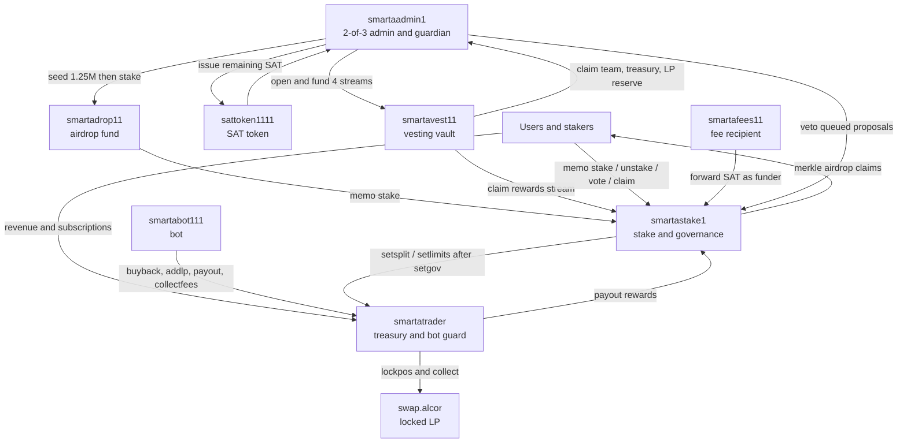

# SAT contract guides

This folder is the full guide set for the Smart Ass Trading (SAT) contracts on WAX (Antelope).

**SAT is not audited yet.** `smartavest` and `smartastake` are written, tested locally, and **not deployed**. Do not create the mainnet accounts, do not mint the remaining supply, and do not sign the lock batches until an external audit is complete and the owner has approved each batch. This documentation is not a signing approval.

These guides describe contract behaviour on [leeftoken/sat-contracts](https://github.com/leeftoken/sat-contracts) `main` after [PR #5](https://github.com/leeftoken/sat-contracts/pull/5) (review fixes, commit `385f945`). They add documentation only. They do not change contract code, tests, or audit files.

| Guide | Account | Status |
|---|---|---|
| [sat.token.md](sat.token.md) | `sattoken1111` | Live. Code hash matches this repo. |
| [leeftrader.md](leeftrader.md) | `smartatrader` | Live. Code hash matches this repo. A later `setgov` patch is required before staking governance can change splits or caps. |
| [smartavest.md](smartavest.md) | `smartavest11` | Built, not deployed, not audited. |
| [smartastake.md](smartastake.md) | `smartastake1` | Built, not deployed, not audited. |
| [airdrop-fund.md](airdrop-fund.md) | `smartadrop11` | Account not created. The fund is a staked, no-vote SAT account inside `smartastake`, not its own contract. |

Related older notes, kept as planning history (the 2026-11-14 decisions below supersede draft numbers where they differ):

- [briefs/grok-vesting-brief.md](briefs/grok-vesting-brief.md)
- [briefs/grok-staking-gov-brief.md](briefs/grok-staking-gov-brief.md)
- [lock-plan/sat-lock-plan.md](lock-plan/sat-lock-plan.md)
- [smartavest/README.md](../smartavest/README.md), [smartavest/docs/SPEC.md](../smartavest/docs/SPEC.md)
- [smartastake/README.md](../smartastake/README.md), [smartastake/docs/TRADER_PATCH.md](../smartastake/docs/TRADER_PATCH.md)
- [AUDIT-REPORT.md](../AUDIT-REPORT.md), [AUDIT-SCOPE.md](../AUDIT-SCOPE.md), [DESIGN.md](../DESIGN.md)

## System overview

SAT is a fixed-supply token (100,000,000.0000 SAT, 4 decimals, no inflation) issued by `sattoken1111`. Live today: 20,000,000.0000 SAT is issued (the 10% community airdrop plus about 10M already in locked Alcor LP). The remaining 80,000,000.0000 SAT is reserved for the lock plan and is still unissued.

`smartatrader` (source: `leeftrader/`) is the live treasury and automation guard. It splits incoming revenue into buckets, lets one bot account run capped buybacks, locked LP adds, fee collection and whitelisted payouts, and is configured by a 2-of-3 admin multisig.

`smartavest11` will hold the long-dated SAT streams (locked-LP reserve, staking rewards, treasury, team). Anyone may call `claim`, and the contract always pays the stream's fixed beneficiary. There is no withdraw, revoke, pause, or beneficiary change.

`smartastake1` will hold user SAT stakes, pay staking rewards, and run bounded governance. `smartadrop11` is the future-airdrop fund: 1,250,000 SAT staked at genesis, no voting power, cannot unstake. Stakers vote on airdrops from that fund. After a trader `setgov` patch, passed votes can also change the trader's revenue split and per-action caps, inside hard bounds.

### Accounts and flows



### Account map

| Account | Role |
|---|---|
| `sattoken1111` | SAT token contract. Issuer: `smartaadmin1`. |
| `smartatrader` | Live treasury / leeftrader contract. |
| `smartaadmin1` | 2-of-3 admin multisig. Token issuer, vest admin, stake admin and guardian, team / treasury / LP-reserve beneficiary. Signers: `danishcrypto@active`, `smart.ass@active`, `leef@active`, threshold 2, weight 1 each. |
| `smartafees11` | Fee recipient (same 2-of-3 pattern). Whitelisted payout target. Will be a staking funder so it can forward SAT as rewards. |
| `smartabot111` | The only bot actor on `smartatrader`. Cannot be a trading account. May pause, not unpause. |
| `smartavest11` | Vesting vault (planned). |
| `smartastake1` | Staking and governance (planned). |
| `smartadrop11` | Airdrop fund account (planned). No contract code. Stakes into `smartastake1`. |
| `swap.alcor` | Alcor swap and CLMM. Locked positions cannot be removed through `smartatrader` (the contract has no `subliquid`). |

Trading accounts (`mywaxgallery`, `danishcrypto`, `qu.ui.wam`, `skgaw.wam`, `dustwizard42`, `niftywarlord`, `smart.ass`) cannot be the bot or a payout destination. The only exception is as **signers** of the admin and fee multisigs, and the fee multisig as a payout target.

## Approved allocation (2026-11-14)

Of the 100,000,000.0000 SAT max supply. Signing the issuance and stream-open batches waits for an external audit.

| Bucket | Share | Amount | Destination | Schedule |
|---|---|---|---|---|
| Community (LEEF holders) | 10% | 10,000,000 | Already airdropped, 2026-11-09 | Done |
| Locked liquidity | 35% | 10,000,000 already in Alcor locked position 153128 (pool 12905, owner `smartafees11`, unlock 2068-10-22); **25,000,000** still to stream | `smartavest11` stream `lpreserve`, beneficiary `smartaadmin1` | Cliff 0, 4-year linear (`1461 * 86400` = 126,230,400 s). Released SAT is added to Alcor `lockpos` in tranches, paired with WAX or LEEF. |
| User rewards | 25% | **23,750,000** | `smartavest11` stream `rewards`, beneficiary `smartastake1` | Cliff 0, 4-year linear. Claims arrive as staking rewards after `setfunder` for `smartavest11`. |
| Future airdrop fund | (5% of the rewards bucket) | **1,250,000** | `smartadrop11`, staked in `smartastake1` at genesis | Permanently staked, no vote, cannot unstake. Grows by compounding its own staking rewards. Airdrops: at most 25% of the fund per drop, at most one every 30 days, 7-day vote, 48-hour timelock. |
| Treasury | 15% | 15,000,000 | `smartavest11` stream `treasury`, beneficiary `smartaadmin1` | Cliff 0, 4-year linear. |
| Team | 15% | 15,000,000 | `smartavest11` stream `team`, beneficiary `smartaadmin1` | 12-month cliff (`365 * 86400` = 31,536,000 s), then 36-month linear (`1095 * 86400` = 94,608,000 s). |

After these issues, circulating supply is 100,000,000.0000 SAT and nothing remains mintable under `max_supply`. New issuance is 1,250,000 (fund seed) + 78,750,000 (four streams) = 80,000,000.

The airdrop fund is taken from the 25% rewards bucket, not from a sixth allocation. A rejected alternative (half staked, half streamed to the fund) is not used, because later vest claims would need a human key on `smartadrop11@active`, which conflicts with locking that permission to `smartastake1@eosio.code`.

## Approved governance numbers

Set at `smartastake1` init. Stakers can later vote to change several of them, but only inside the hard bounds in the contract.

| Parameter | Approved value | Stored units | Later change? |
|---|---|---|---|
| Proposal threshold | 10,000 SAT staked | `proposal_threshold = 100000000` | Not a votable kind in v1 (fixed at init). |
| Quorum | 10% of votable-stake snapshot | `quorum_bps = 1000` | Not a votable kind in v1. |
| Approval | more than or equal to 50% of votes cast | `approval_bps = 5000` | Not a votable kind in v1. |
| Voting period | 3 days | `voting_period_secs = 259200` | Not a votable kind in v1. Airdrop votes are at least 7 days even if this is shorter. |
| Timelock | 2 days | `timelock_secs = 172800` | Not a votable kind in v1. Airdrop timelock is at least 48 hours. |
| Unstake cooldown | 7 days, adjustable 3–30 days | `cooldown_secs = 604800`, `min_cooldown = 259200`, `max_cooldown = 2592000` | Yes, kind `setcooldown`. |
| Guardian | `smartaadmin1` (veto while queued) | `guardian` | Not votable. See [Multisig signer management](#multisig-signer-management). |
| SAT LP fee share (bot knob) | 50% | `sat_lp_fee_share_bps = 5000` | Yes, kind `setsatlps` (bounds 10%–80%). |
| Buyback share (bot knob) | 0% | `buyback_share_bps = 0` | Yes, kind `setbuyback` (bounds 0%–50%). |
| Airdrop fund recorded share | 5% of the rewards bucket | `airdrop_alloc_bps = 500` | Recorded at init only (allowed range 2.5%–5%). The contract does not skim this off transfers. |
| Novote at init | `smartadrop11`, `smartaadmin1`, `smartafees11` | `novote` table | Fund cannot be removed. Other entries can be removed by kind `delnovote`. |

Passing `setsplit` or `setlimits` also requires the trader `setgov` patch described in [leeftrader.md](leeftrader.md#governance-patch-setgov) and [smartastake/docs/TRADER_PATCH.md](../smartastake/docs/TRADER_PATCH.md). Until that patch is live, those proposals cannot execute on `smartatrader`.

## Deploy and launch order

Operational order. The contracts do not enforce every prerequisite, so doing this out of sequence can strand funds or leave a gap a first staker can take.

| Batch | What | Why this position |
|---|---|---|
| Before B0 | External audit. Fund `smartaadmin1` with about 530 WAX for RAM and CPU. | Accounts cannot be created on an empty payer. |
| **B0** | Create `smartavest11`, `smartastake1`, `smartadrop11`. Set vest and stake code. Active authorities include `eosio.code` on the two contract accounts. | Accounts and code first. Planned hashes: vest `b6166eae…a532`, stake `dff935d9…a2ad` (main after PR #5). Rebuild with CDT 4.1.1 to confirm. |
| **B1** | `smartavest11::init` and `smartastake1::init` with the governance numbers above. | Once only. |
| **B2** | Issue 1,250,000 SAT, move it to `smartadrop11`, stake it (`memo: stake`) **before any reward arrives**. | While `total_staked == 0`, rewards are held and the first staker receives all of them. After the fund is in, `total_staked` cannot return to zero (airdrops take at most 25% of the fund). |
| **B3** | `setfunder` for `smartavest11` and `smartafees11`. | Vest claims use memo `vesting claim`. Without this, those claims revert. Must happen before the stake admin is retired. |
| **B4** | Issue 78,750,000 SAT and open the four streams, in order `lpreserve`, `rewards`, `treasury`, `team`. | Stream ids follow that open order (0..3 if nothing else is opened first). Supply then equals max supply. |
| **B5** | Patch `smartatrader` with `binary_extension<name> gov` and call `setgov("smartastake1")` from `smartaadmin1`. | Must happen before governance queues `setsplit` or `setlimits`. A plain `name gov` field bricks the live config singleton. |
| **B6** | Set `smartadrop11@active` to `smartastake1@eosio.code` only. Optional later freezes (code freeze, retiring the vest/stake admin) are separate, partly irreversible decisions. | Freezes last. |
| After | Prefer many small reward transfers over rare large lumps (see known limits). | Reward streaming is not in v1. |

Unsigned draft packs for B0–B6 live in the operator working tree, not in this public guide. Nothing in those packs is signed, proposed, or broadcast as of this writing.

## Multisig signer management

`smartaadmin1` (and the same pattern on `smartafees11`) is a 2-of-3 account: `danishcrypto@active`, `smart.ass@active`, and `leef@active`, each weight 1, threshold 2.

The two contract suites do not freeze this. The admin multisig can, at any time, add a signer, remove a signer, or change the threshold by a normal `updateauth` that itself needs 2 of the current 3 `active` approvals. That is how a leaked wallet is rotated:

1. Create or designate a replacement account. Do not reuse the leaked key.
2. Two of the current signers approve an `updateauth` on `smartaadmin1@active` (and on `smartafees11@active` if that account uses the same set) that swaps the leaked actor for the new one, or removes it and adjusts the threshold if you are temporarily going to 2-of-2.
3. Repeat for `owner` if the leaked actor is also an owner signer, so the leaked key cannot restore itself.
4. Confirm the new authority with `get account`, then treat the leaked key as burned.

Example shape (illustrative names only; fill in the live signer list at the time of the change, and do not commit keys or a filled-in permission JSON with private material):

```bash
# Requires 2-of-3 on smartaadmin1@active. Replace LEAKED with NEWACCT.
cleos set account permission smartaadmin1 active '{
  "threshold": 2,
  "keys": [],
  "accounts": [
    {"permission":{"actor":"REMAINING1","permission":"active"},"weight":1},
    {"permission":{"actor":"REMAINING2","permission":"active"},"weight":1},
    {"permission":{"actor":"NEWACCT","permission":"active"},"weight":1}
  ],
  "waits": []
}' owner -p smartaadmin1@owner
```

Stakers cannot vote the guardian or the multisig signers in or out. Those stay with the multisig itself.

## Reproducible builds

AntelopeIO CDT **4.1.1**.

```bash
CDT_BIN=/path/to/cdt/usr/bin ./build.sh
sha256sum build/sat.token.wasm build/leeftrader.wasm

cd smartavest && ./build.sh
cd ../smartastake && ./build.sh
```

Live code hashes, matching a CDT 4.1.1 `-O3` rebuild of this repo:

| Account | sha256 |
|---|---|
| `sattoken1111` | `e1702842a5cc049c592abc92aabfbd2e02325c709b401629f5b3634d2dcf7dbc` |
| `smartatrader` | `4ed7d02a7f7107dc03d9c9df61b77fd4927368ea95b669e0d0ba228f1ee729c4` |

Planned, not on mainnet (rebuild to verify; wasm is not committed):

| Account | sha256 (CDT 4.1.1, `-O3`, no test clock) |
|---|---|
| `smartavest11` | `b6166eae6560e8bc43ac2bafed01ec58e7476fa30e297ddbe4c85074a54ae532` |
| `smartastake1` | `dff935d9797bac8a16bea24a42b4061cf066a42cd401dd9b541320fc6f42a2ad` |

Production vest and stake ABIs must not contain `setnow` or `settime`. The test builds that add a clock are for local suites only and must not be deployed.

`mocks/` and the `sat.token/` trees under `smartavest/` and `smartastake/mocks/` are local test stand-ins. Do not deploy them and do not copy them over the root `sat.token/` or `leeftrader/` sources.
